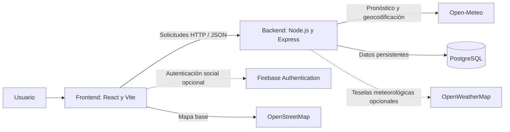
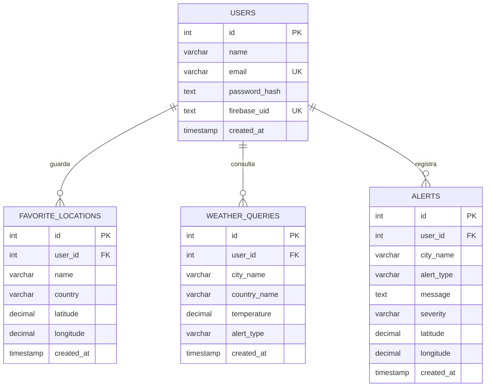

# Primera revisión: planeación y diseño del sistema

**Proyecto:** Panel de clima y alertas ambientales  
**Curso:** Desarrollo Web  
**Fecha:** 7 de octubre de 2026  
**Estado del avance:** Planeación y diseño inicial  
**Repositorio GitHub:** Pendiente de creación

## 1. Descripción del problema

La información meteorológica suele consultarse en diferentes servicios y formatos. Esto dificulta revisar rápidamente las condiciones de una ubicación, anticipar eventos de riesgo y comparar el pronóstico de las próximas horas o días.

El proyecto propone un panel web que centraliza la consulta del clima por ciudad o ubicación. Presenta las condiciones actuales y el pronóstico, identifica situaciones que requieren atención y permite conservar ubicaciones favoritas y el historial de búsquedas de cada usuario.

### Objetivo general

Diseñar e implementar una aplicación web responsiva para consultar información meteorológica y facilitar el seguimiento de alertas ambientales por ubicación.

### Objetivos específicos

- Buscar ubicaciones y consultar sus condiciones actuales.
- Presentar pronósticos por hora y por día con variables meteorológicas relevantes.
- Identificar y resaltar condiciones como tormentas, temperaturas extremas, viento fuerte e índices UV elevados.
- Permitir autenticación, almacenamiento de favoritos e historial asociado a cada usuario.
- Mostrar la ubicación y las alertas en un mapa.

## 2. Arquitectura del sistema

La solución utiliza una arquitectura por capas. El frontend presenta la experiencia y consume una API REST. El backend valida las solicitudes, consulta servicios meteorológicos externos, aplica las reglas de alerta y accede a PostgreSQL. Firebase Authentication puede utilizarse para el inicio de sesión social.



### Componentes

| Componente | Responsabilidad |
| --- | --- |
| React, Vite y React Leaflet | Interfaz responsiva, búsqueda, visualización del pronóstico y mapa. |
| Node.js y Express | API REST, validación, autenticación, reglas de alertas e integración con servicios externos. |
| PostgreSQL | Usuarios, ubicaciones favoritas, historial de consultas y alertas registradas. |
| Open-Meteo | Datos de clima actual, pronóstico, geocodificación y variables astronómicas disponibles. |
| OpenStreetMap | Mapa base para ubicar la ciudad consultada y las alertas. |
| Firebase Authentication | Proveedores opcionales de acceso social; el backend valida sus tokens. |
| OpenWeatherMap | Capas meteorológicas opcionales del mapa, configuradas desde el backend. |

Las claves privadas de los servicios externos se configuran en el backend y no se exponen en el frontend.

## 3. Modelo de base de datos

El esquema relacional inicial consta de cuatro entidades. Las relaciones se realizan mediante `user_id`; las claves foráneas eliminan los registros asociados cuando se elimina el usuario.



### Reglas y restricciones principales

- `users.email` es único. La cuenta puede autenticarse con contraseña o vincularse a Firebase mediante `firebase_uid`.
- `favorite_locations` evita duplicar el nombre de una ubicación para el mismo usuario mediante una restricción única compuesta.
- `weather_queries` conserva ciudad, país, temperatura y tipo de alerta asociado a la consulta.
- `alerts` guarda tipo, mensaje, severidad y coordenadas para que la alerta pueda mostrarse en el mapa.
- Los valores de latitud y longitud usan precisión decimal para coordenadas geográficas.

## 4. Wireframes iniciales

Los siguientes esquemas muestran la jerarquía y los elementos principales; no representan el diseño visual final.

### 4.1 Acceso y registro

```text
+------------------------------------------------------------------+
| LOGO / NOMBRE DEL SISTEMA           | Bienvenido                 |
|                                      | Accede a tu panel          |
| Resumen visual del clima            | [ Iniciar sesión ]         |
| Ciudades destacadas                 | [ Registrarme    ]         |
|                                      | Correo                     |
|                                      | Contraseña                 |
|                                      | [ Entrar al panel ]        |
|                                      | Acceso social opcional     |
+------------------------------------------------------------------+
```

### 4.2 Resumen y búsqueda

```text
+------------------------------------------------------------------+
| LOGO       Resumen   Pronóstico   5 días   Mi actividad   Salir  |
+------------------------------------------------------------------+
| Ciudad consultada     Consultas recientes     Favoritos    Alertas|
+------------------------------------------------------------------+
| Estado del día                                                    |
| Temperatura              Humedad              Precipitación       |
+------------------------------------------------------------------+
| Buscar ciudad o lugar                                      [Buscar]|
| Sugerencias de ubicación                                          |
+------------------------------------------------------------------+
| Ubicación actual       Hora local · Fecha · Día        [Favorito] |
| Temperatura actual     Condición       Métricas principales       |
+------------------------------------------------------------------+
```

### 4.3 Pronóstico y seguimiento

```text
+------------------------------------------------------------------+
| Salida y puesta del sol              Calendario lunar             |
| [gráfica del recorrido solar]        [fase · salida · puesta]     |
+------------------------------------------------------------------+
| Próximas 8 horas: condición, temperatura, humedad, lluvia, viento,|
| presión, visibilidad, UV y periodo día/noche                      |
+------------------------------------------------------------------+
| Mapa climático                                                    |
+------------------------------------------------------------------+
| Pronóstico de 5 días: temperaturas, precipitación, viento y UV    |
| Las tormentas previstas se resaltan por hora y por día.           |
+------------------------------------------------------------------+
| Accesos rápidos: consultas recientes · favoritos · alertas        |
+------------------------------------------------------------------+
```

## 5. Repositorio GitHub

**Pendiente de creación y vinculación.** El repositorio no forma parte de los entregables completados de este avance. Una vez creado, aquí se registrará su URL para identificar el origen del código y dar seguimiento a los cambios.

## 6. Alcance de esta revisión

Esta revisión documenta el problema, la arquitectura propuesta, el modelo de datos inicial y la estructura de las pantallas principales. La implementación puede evolucionar a partir de pruebas de uso, comentarios del equipo y validaciones de los servicios externos.
